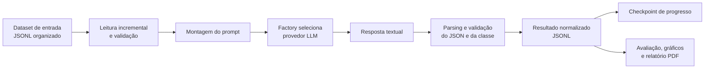

<div align="center">

# Tipificação Penal por LLMs e ATP

**Projeto de Trabalho de Conclusão de Curso — UFRRJ**

Pesquisa e implementação de um pipeline experimental para classificação de condutas relacionadas a crimes contra a Administração Pública, avaliação taxonômica e comparação de resultados produzidos por modelos de linguagem.

</div>

> **Uso exclusivamente acadêmico e experimental.** As classificações e justificativas geradas por modelos de linguagem podem conter erros e não constituem aconselhamento jurídico, parecer, decisão ou substituto da análise de profissionais qualificados.

## Sobre o projeto

Este projeto investiga o uso de modelos de linguagem (LLMs) na classificação de narrativas fáticas em categorias penais previamente definidas. A aplicação processa conjuntos de dados em JSONL, solicita uma classificação estruturada ao provedor configurado, valida a resposta e persiste os resultados para posterior avaliação.

Além da acurácia exata, o projeto implementa a **Acurácia Taxonômica Ponderada (ATP)**: uma medida que atribui crédito parcial a uma predição incorreta quando a classe predita e a classe real pertencem ao mesmo grupo semântico da taxonomia adotada.

O repositório inclui conjuntos identificados como curado e sintético, resultados classificados, a taxonomia usada pela métrica e módulos para gerar métricas, gráficos e relatórios. A presença de resultados no repositório não deve ser interpretada, por si só, como validação jurídica ou científica independente.

## Escopo e categorias

O prompt restringe a classificação a estas categorias:

- `peculato`
- `peculato_culposo`
- `peculato_mediante_erro_de_outrem`
- `concussao`
- `corrupcao_passiva`
- `prevaricacao`
- `condescendencia_criminosa`
- `advocacia_administrativa`
- `violacao_de_sigilo_funcional`
- `nao_se_enquadra`

Os grupos usados no cálculo da ATP estão definidos em [`data/vade_mecum_taxonomy.json`](data/vade_mecum_taxonomy.json). Essa taxonomia é uma configuração do experimento; suas associações semânticas devem ser interpretadas no contexto metodológico do TCC, e não como uma conclusão jurídica universal.

## Fluxo da aplicação



O processamento é realizado por registro. O resultado é gravado antes da atualização do progresso; o arquivo de progresso é atualizado de forma atômica. O estado é separado por combinação de modelo e dataset, permitindo retomar o processamento após uma interrupção sem solicitar novamente resultados que já foram persistidos.

## Arquitetura

| Módulo | Responsabilidade |
|---|---|
| `src/config.py` | Carregar e validar `config.yaml`, caminhos e credenciais do ambiente. |
| `src/init.py` | Configurar logging e iniciar o pipeline de classificação. |
| `src/pipeline.py` | Orquestrar leitura, prompt, provedor, parsing, persistência e progresso. |
| `src/leitura/` | Ler JSONL incrementalmente e validar registros de entrada. |
| `src/prompts/` | Construir o prompt e definir as classes permitidas. |
| `src/llm/` | Definir o contrato de provedor, selecionar implementações e chamar APIs externas. |
| `src/parsing/` | Limpar e validar a resposta JSON produzida pelo modelo. |
| `src/resultados/` | Normalizar e gravar resultados de classificação em JSONL. |
| `src/progresso/` | Carregar e atualizar checkpoints por modelo e dataset. |
| `src/metrics/` | Implementar estratégias de acurácia exata, ATP e métricas macro. |
| `src/avaliacao/` | Ler resultados, calcular métricas e executar a avaliação por bootstrap. |
| `src/relatorios/` | Gerar matrizes de confusão e relatórios em PDF. |
| `src/utils/` e `src/visualizacao/` | Oferecer conversão de JSONL para CSV e geração de amostras visuais. |
| `tests/` | Testes unitários e de integração do pipeline e das regras de negócio. |

A camada de LLM segue um contrato comum (`ProvedorLLM`) e uma fábrica (`criar_provedor_llm`), mantendo as chamadas aos SDKs fora do pipeline.

## Estrutura do repositório

```text
.
├── config.yaml
├── data/
│   ├── raw/          # Fontes de dados JSON
│   ├── organized/    # Entradas organizadas em JSONL e CSV
│   ├── classified/  # Saídas classificadas em JSONL e CSV
│   ├── results/     # Métricas, imagens e relatórios
│   ├── vade_mecum_taxonomy.json
│   └── progresso_processamento.json
├── src/
│   ├── avaliacao/
│   ├── leitura/
│   ├── llm/
│   ├── metrics/
│   ├── parsing/
│   ├── progresso/
│   ├── prompts/
│   ├── relatorios/
│   ├── resultados/
│   ├── utils/
│   ├── visualizacao/
│   ├── config.py
│   ├── init.py
│   ├── init_avaliacao.py
│   └── pipeline.py
├── tests/
│   ├── integration/
│   └── unit/
├── requirements.txt
└── LICENSE
```

## Requisitos

- Python 3.11 ou superior.
- Chave de API válida para o provedor selecionado.
- Acesso à internet para chamadas aos provedores externos.
- Dependências listadas em [`requirements.txt`](requirements.txt).


## Instalação

Crie e ative um ambiente virtual na raiz do repositório:

```powershell
py -3.11 -m venv venv
.\venv\Scripts\Activate.ps1
python -m pip install --upgrade pip
python -m pip install -r requirements.txt
```

No macOS ou Linux:

```bash
python3.11 -m venv venv
source venv/bin/activate
python -m pip install --upgrade pip
python -m pip install -r requirements.txt
```

## Configuração

### Chaves de API

As chaves são carregadas do ambiente ou de um arquivo `.env` na raiz. O arquivo `.env` está listado no `.gitignore`; não versione credenciais.

Variáveis lidas pela aplicação:

| Provedor configurado | Variável de ambiente |
|---|---|
| Google Gemini (`google`) | `GOOGLE_API_KEY` |
| OpenAI compatível/Groq (`openai`) | `OPEN_AI_API_KEY` |
| DeepSeek via OpenRouter (`openrouter`) | `OPENROUTER_API_KEY` |

Exemplo de `.env` — substitua o valor de exemplo por uma chave própria:

```dotenv
OPENROUTER_API_KEY=sua_chave_aqui
```

### Seleção de modelo e dataset

Edite `config.yaml` antes de executar:

- `llm.active_model` deve corresponder a uma chave existente em `llm.models`.
- `datasets.active_dataset` deve ser o nome do arquivo JSONL de entrada localizado em `data/organized/` quando o objetivo for executar o pipeline.
- `llm.delays.request_delay_seconds` define o intervalo entre chamadas.
- Para o modelo OpenRouter, `max_tokens` limita a quantidade máxima de tokens de resposta por requisição.
- `metrics.atp_alpha_weight` define o peso da pontuação parcial da ATP, entre 0 e 1.

Exemplo de seleção para classificar o dataset curado com o modelo OpenRouter configurado como `modelo_3`:

```yaml
datasets:
  active_dataset: "dataset_curado_organizado.jsonl"

llm:
  active_model: "modelo_3"
```

O modelo `modelo_3` usa `~deepseek/deepseek-flash-latest` via OpenRouter e está configurado com `max_tokens: 4096`. Os identificadores de modelo e limites podem depender da disponibilidade e das regras atuais do provedor.

> **Atenção à configuração presente no repositório:** no estado atual, `llm.active_model` está definido como `deepseek-v4.1-flash`, que não corresponde a nenhuma chave declarada em `llm.models`. Além disso, `datasets.active_dataset` aponta para um arquivo classificado, enquanto o pipeline resolve esse nome dentro de `data/organized/`. Ajuste esses campos antes de iniciar uma nova classificação.

## Formato dos dados

Cada linha do dataset de entrada deve ser um objeto JSON independente e conter, no mínimo:

```json
{
  "id": 1,
  "nível": "fácil",
  "texto": "<descrição da conduta a ser analisada>",
  "classe_correta": "peculato"
}
```

O campo `id` deve ser um inteiro não negativo; `texto` deve conter a narrativa a ser enviada ao modelo. O código aceita `nível` e normaliza esse campo como `nivel` na saída.

O resultado classificado é salvo como JSONL, uma linha por registro:

```json
{
  "id": 1,
  "nivel": "fácil",
  "texto": "<descrição da conduta>",
  "classe_real": "peculato",
  "classe_predita": "peculato",
  "justificativa": "<justificativa textual produzida pelo modelo>"
}
```

As narrativas podem conter informações sensíveis. Antes de compartilhar datasets, logs ou resultados, verifique a origem, as permissões de uso e a necessidade de anonimização.

## Executar a classificação

Após configurar `active_model`, `active_dataset` e a variável de ambiente do provedor:

```bash
python -m src.init
```

O resultado será acrescentado ao arquivo correspondente em `data/classified/`. O progresso por modelo e dataset é mantido em `data/progresso_processamento.json`. O pipeline falha explicitamente quando encontra entrada inválida, resposta que não atende ao contrato ou erro do provedor; respostas inválidas não são convertidas silenciosamente em classificações.

## Avaliação dos resultados

Para avaliar um arquivo JSONL classificado e gerar um resumo:

```bash
python -m src.init_avaliacao \
  --dataset data/classified/resultados_classificados_modelo_3_dataset_curado.jsonl
```

O módulo de avaliação calcula:

- **Acurácia simples:** proporção de classes preditas exatamente iguais às classes reais.
- **Acurácia taxonômica ponderada (ATP):** média das pontuações por registro:
  - `1` para correspondência exata;
  - `alpha` para classes diferentes que pertencem ao mesmo grupo da taxonomia;
  - `0` para os demais casos.
- **Precisão, recall e F1 macro.**
- **Acurácia exata e taxonômica por nível** (`fácil`, `médio` e `difícil`).

O valor de `alpha` é lido de `metrics.atp_alpha_weight` em `config.yaml`. A avaliação também gera artefatos em `data/results/`: resumo JSON, matriz de confusão PNG e relatório PDF.

Os nomes e metadados desses relatórios usam valores da configuração ativa. Ao avaliar um arquivo de outro modelo ou dataset, confira se `llm.active_model` e `datasets.active_dataset` representam o resultado avaliado; o argumento `--dataset` seleciona o arquivo, mas não substitui esses rótulos da configuração.

### Avaliação por bootstrap

O módulo [`src/avaliacao/bootstrap_evaluator.py`](src/avaliacao/bootstrap_evaluator.py) implementa reamostragem bootstrap da acurácia exata, globalmente e por nível de explicitude, com 1.000 iterações, intervalo de confiança de 95% e semente fixa.

Para executá-lo utilize o comando:

```bash
python -m src.avaliacao.bootstrap_evaluator
```

O módulo percorre os arquivos classificados de `data/classified/` que correspondem aos nomes de modelos e datasets definidos no próprio código e grava `bootstrap_evaluation_results.json` em `data/results/`.

## Testes

Execute os testes automatizados a partir da raiz do projeto:

```bash
python -m pytest
```

A suíte inclui testes de leitura JSONL, validação do prompt e do parsing, montagem e persistência de resultados, seleção de provedores, métricas e retomada do pipeline com provedores simulados. Os testes não requerem uma chamada real a uma API de LLM.

## Limitações e uso responsável

- Uma resposta estruturalmente válida não é necessariamente uma interpretação jurídica correta.
- A pontuação ATP depende dos grupos semânticos configurados; não mede todos os aspectos da análise penal.
- Modelos, provedores, prompts e parâmetros de inferência podem mudar e afetar a reprodutibilidade.
- Chamadas a APIs externas podem transmitir o texto dos casos ao provedor selecionado. Avalie privacidade, base legal, termos de uso e segurança antes de enviar dados.
- Resultados experimentais devem ser interpretados em conjunto com a metodologia, a composição dos datasets e suas limitações; nenhuma métrica isolada comprova adequação para uso jurídico real.
- O sistema é uma ferramenta de pesquisa e não deve ser usado para tomar decisões sobre pessoas ou casos concretos.

## Licença

Este projeto está disponibilizado sob a licença MIT. Consulte [`LICENSE`](LICENSE) para os termos completos.
